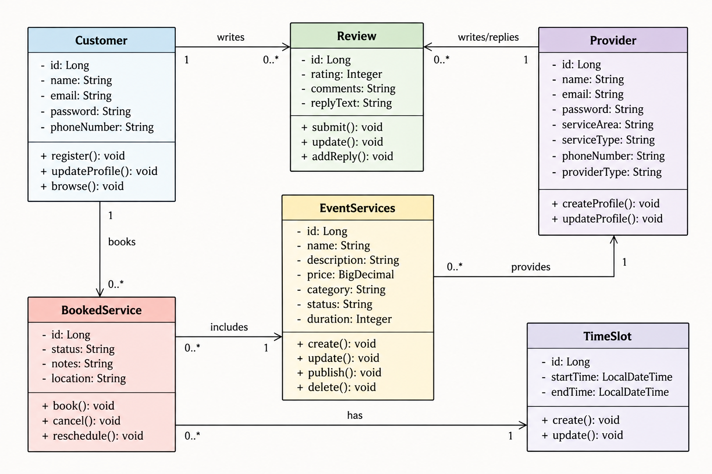

## UML Diagram



## API Overview

**Version:** 1.0  
**Last Updated:** October 23, 2026

**Base URL:**

- local: `http://localhost:8080/api`

## Live Deployment

https://f26-team3.onrender.com

## Customer Profile Management

| Method | Path | Purpose | Response Code | User Story / Use Case | Implemented By |
| ------ | ---- | ------- | ------------- | --------------------- | -------------- |
| `POST` | `/api/customers` | Create a customer profile | `201 Created` | Create Customer Profile | Justin |
| `GET` | `/api/customers/{id}` | Retrieve a customer profile by ID | `200 OK` | View Customer Profile | Justin |
| `PUT` | `/api/customers/{id}` | Update a customer profile | `200 OK` | Modify Customer Profile | Justin |
| `DELETE` | `/api/customers/{id}` | Delete a customer profile by ID | `204 No Content` | Delete Customer Profile | Justin |

### Example Customer Requests

#### Create a Customer

```http
POST /api/customers
Content-Type: application/json

{
  "name": "John Doe",
  "email": "john.doe@example.com",
  "password": "ExamplePassword123!",
  "phoneNumber": "3365550101"
}
```

#### Update a Customer

```http
PUT /api/customers/1
Content-Type: application/json

{
  "name": "John Doe",
  "email": "john.doe.updated@example.com",
  "password": "UpdatedExamplePassword123!",
  "phoneNumber": "3365550199"
}
```

#### Get a Customer

```http
GET /api/customers/1
```

#### Delete a Customer

```http
DELETE /api/customers/1
```